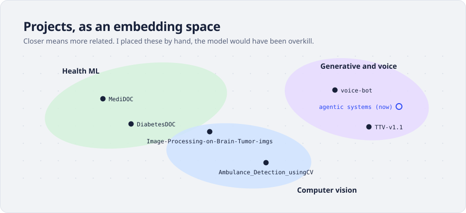
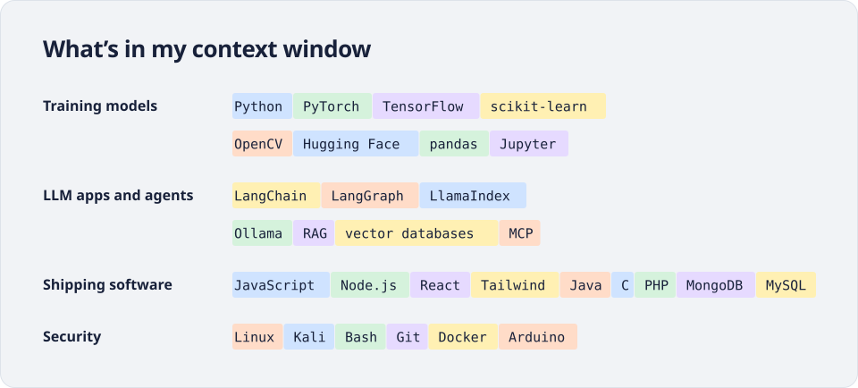

<picture>
  <source media="(prefers-color-scheme: dark)" srcset="./assets/hero-dark.svg">
  
</picture>

### Right now

I'm building agentic AI: systems that plan, call tools, and recover when a step goes wrong. Most of my time goes into figuring out where an AI solution genuinely beats the existing workflow, and where it doesn't.

If you're working on something with LLMs, I'd like to hear about it. I'm also happy to talk about neural nets, agents, or whether we're in an AI bubble.

<picture>
  <source media="(prefers-color-scheme: dark)" srcset="./assets/projects-dark.svg">
  
</picture>

| Project | What it does |
| --- | --- |
| [voice-bot](https://github.com/whileTrueFalse/voice-bot) | A digital clone of me you can talk to |
| [MediDOC](https://github.com/whileTrueFalse/MediDOC) | ML models for medical diagnosis |
| [DiabetesDOC](https://github.com/whileTrueFalse/DiabetesDOC) | Predicts diabetes risk from patient data |
| [Image-Processing-on-Brain-Tumor-imgs](https://github.com/whileTrueFalse/Image-Processing-on-Brain-Tumor-imgs) | Image processing on brain tumor scans |
| [Ambulance_Detection_usingCV](https://github.com/whileTrueFalse/Ambulance_Detection_usingCV) | Spots ambulances in traffic footage |
| [TTV-v1.1](https://github.com/whileTrueFalse/TTV-v1.1) | Text-to-video experiments |

Everything else is on my [portfolio](https://samarth-pfolio.vercel.app/).

<picture>
  <source media="(prefers-color-scheme: dark)" srcset="./assets/stack-dark.svg">
  
</picture>

  <picture>
    <source media="(prefers-color-scheme: dark)" srcset="https://github-readme-stats.vercel.app/api?username=whileTrueFalse&show_icons=true&include_all_commits=true&count_private=true&bg_color=131A2C&title_color=E8EBF3&text_color=A5AEC4&icon_color=7D93FF&border_color=25304A&border_radius=16">
    
  </picture>
  <picture>
    <source media="(prefers-color-scheme: dark)" srcset="https://github-readme-stats.vercel.app/api/top-langs/?username=whileTrueFalse&layout=compact&langs_count=6&bg_color=131A2C&title_color=E8EBF3&text_color=A5AEC4&border_color=25304A&border_radius=16">
    
  </picture>

### Get in touch

The quickest way to reach me is [email](mailto:samarthganorkar@gmail.com). I'm also on [LinkedIn](https://www.linkedin.com/in/samarth-ganorkar-5549a8203/) and [X](https://twitter.com/samarthganorkar), and my work history is [here](https://www.canva.com/design/DAGZhHc9soE/gqIUEd2JN27x0hGJpRQvLw/view).
