<code>$ open</code>&nbsp;
<a href="https://samerths-voicebot-v2.onrender.com/">voice-bot ↗</a> ·
<a href="https://ttv-v1-1.onrender.com">ttv-v1.1 ↗</a> ·
<a href="https://github.com/whileTrueFalse/MediDOC">medidoc</a> ·
<a href="https://github.com/whileTrueFalse/DiabetesDOC">diabetesdoc</a> ·
<a href="https://github.com/whileTrueFalse/Ambulance_Detection_usingCV">ambulance-cv</a> ·
<a href="https://github.com/whileTrueFalse/Image-Processing-on-Brain-Tumor-imgs">tumor-imgproc</a>

